<p align="center"></p>

<h1 align="center">BlueScreen</h1>

<p align="center">
Uma IDE leve para Windows, com as melhores funcionalidades do mercado.<br>
Abre em menos de meio segundo, ocupa 25 MB e conversa com as ferramentas oficiais de cada linguagem.
</p>

<p align="center">


</p>

<p align="center">
<a href="#instalar">Instalar</a> ·
<a href="#primeiros-passos">Primeiros passos</a> ·
<a href="#linguagens">Linguagens</a> ·
<a href="#comparativo">Comparativo</a> ·
<a href="#recursos-em-detalhe">Recursos</a> ·
<a href="#como-funciona-por-dentro">Arquitetura</a> ·
<a href="#plugins">Plugins</a>
</p>

<p align="center">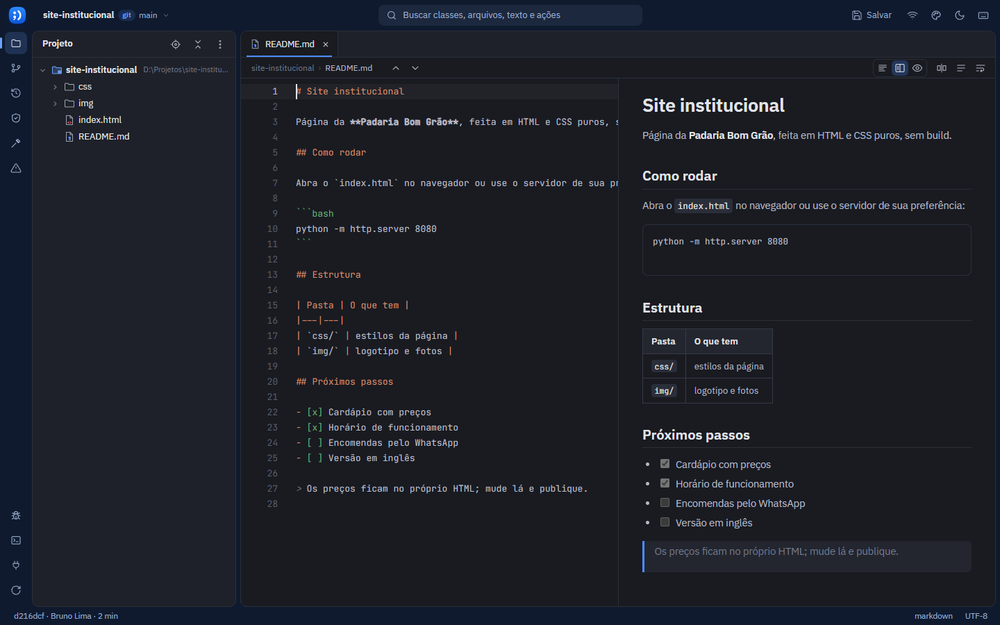</p>

## O que é

O BlueScreen nasceu para **ler, revisar, ajustar, rodar e depurar código** sem esperar uma IDE pesada abrir. O núcleo é em Rust e a janela é nativa (WebView2); o editor é o Monaco, o mesmo do VS Code.

Ele não reimplementa cada linguagem. Para análise, refatoração e depuração, usa as ferramentas oficiais que você já instala no PC (rust-analyzer, gopls, pyright, clangd, jdtls, debugpy, Delve...), pelos mesmos protocolos do VS Code (LSP e DAP). Assim, cada linguagem fica tão boa quanto a ferramenta dela.

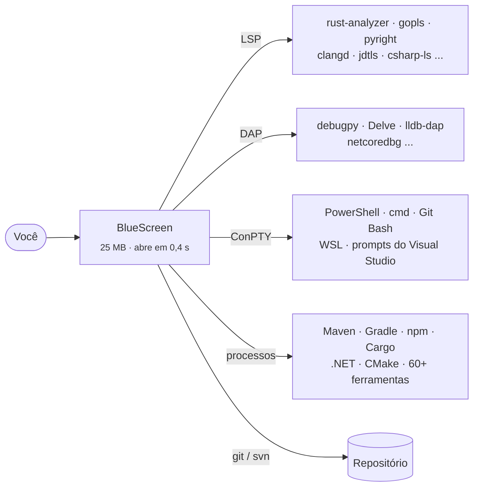

A ideia em uma frase: **a IDE é fina e as ferramentas são as de verdade.** Quando o pyright ou o rust-analyzer melhora, o BlueScreen melhora junto, sem atualizar nada.

## Destaques

| | |
|---|---|
| 🌿 **Git e SVN** | alterações, diff lado a lado, histórico e marcas na margem do editor |
| 🧠 **Análise e refatoração** | qualquer linguagem com servidor LSP: renomear em todos os arquivos, ir para a definição, usos, ações rápidas, erros enquanto digita |
| 🐞 **Depurador** | breakpoints (inclusive com condição), passo a passo, pilha, variáveis e console |
| 🖥️ **Terminal** | PowerShell, cmd, Git Bash, WSL, prompts do Visual Studio e perfis do Windows Terminal |
| 👀 **Visualização ao vivo** | Markdown e HTML ao lado do código |
| 🔨 **Build reconhecido sozinho** | Maven, Gradle, npm, Cargo, .NET, CMake e mais de 60 ferramentas |
| 🔎 **Buscar em tudo** | `Shift` duas vezes, como no IntelliJ |
| ✅ **Lint sem instalar nada** | cerca de mil extensões e nomes de arquivo reconhecidos, com o Linter Universal para 16 linguagens |
| 📜 **Arquivos gigantes** | logs, dumps e CSVs de vários GB abertos na hora, com busca no arquivo inteiro |
| 🔄 **Alterações de fora** | o que outro programa grava no disco entra no editor, com merge de três vias se você também mexeu |
| 📱 **Abrir pelo celular** | ou por outro PC da rede local, com PIN |
| 🧩 **Plugins** | em JavaScript (interface) e, se precisar, um servidor próprio em qualquer linguagem |

<table>
<tr>
<td width="50%">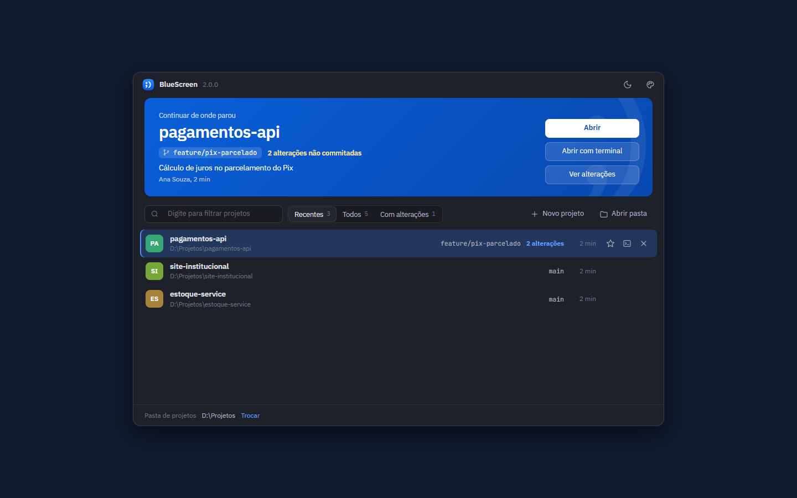<br><sub>Sem projeto aberto, a tela de boas-vindas leva de volta ao último projeto, com o que ficou pendente.</sub></td>
<td width="50%">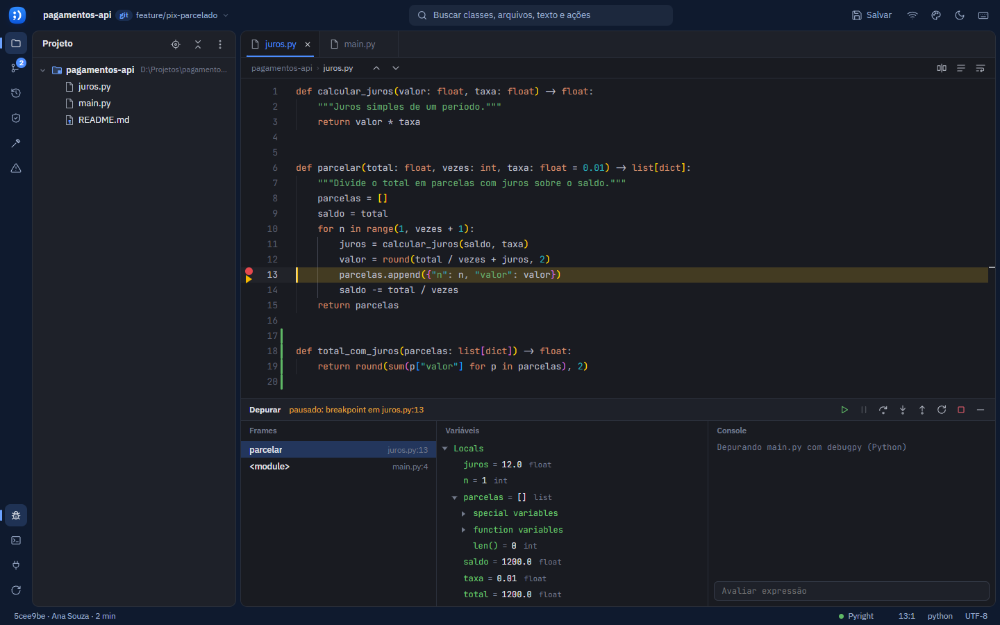<br><sub>Depurador pausado: linha atual, frames da pilha e variáveis.</sub></td>
</tr>
<tr>
<td>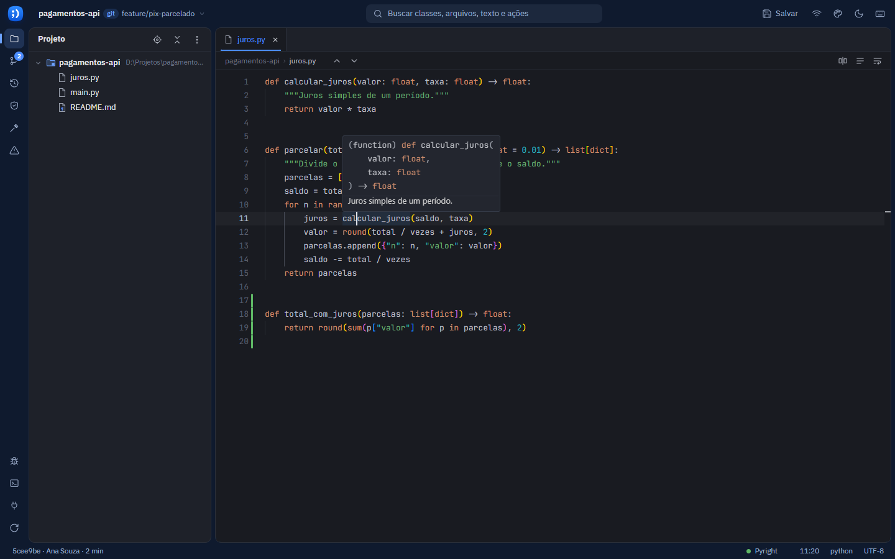<br><sub>Tipos e documentação vindos do servidor da linguagem (aqui, o Pyright).</sub></td>
<td>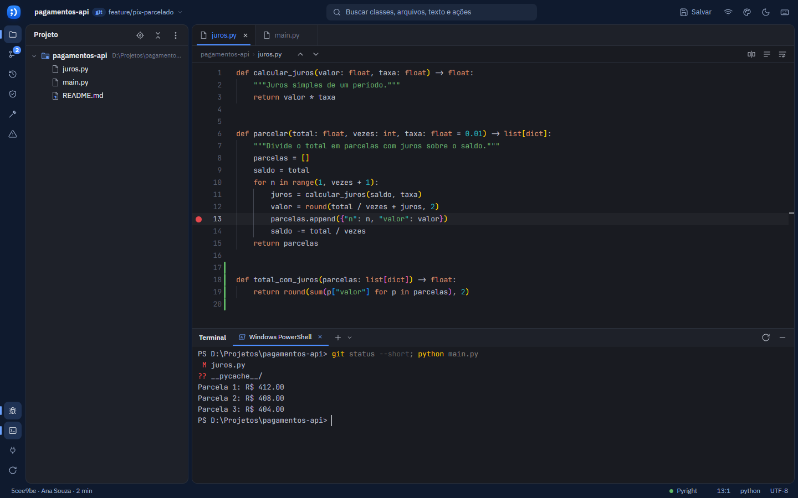<br><sub>Terminal na pasta do projeto, com abas e o shell que você escolher.</sub></td>
</tr>
<tr>
<td colspan="2">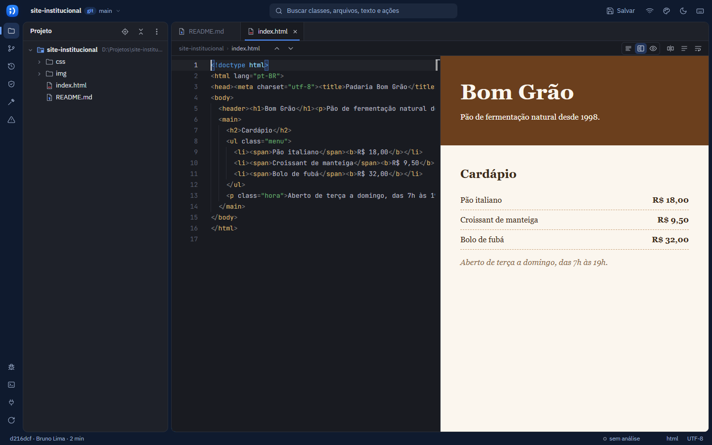<br><sub>HTML ao vivo: a página é refeita com o texto ainda não salvo, carregando CSS, imagens e scripts do projeto.</sub></td>
</tr>
</table>

## Instalar

Precisa de Windows 10 ou 11, 64 bits, com o [WebView2](https://developer.microsoft.com/microsoft-edge/webview2/), que já vem no Windows 11.

### Pelo setup (recomendado)

Baixe o `BlueScreen-Setup-X.Y.Z.exe` da última versão na [página de releases](https://github.com/martindevbr/BlueScreen-IDE/releases/latest) e siga o assistente: escolha a pasta, os atalhos (área de trabalho e menu Iniciar) e pronto. Instala só para o seu usuário, sem administrador, e aparece em Configurações › Apps com desinstalador. Não precisa de Rust nem do código-fonte.

### Pelo zip

Baixe o `BlueScreen-X.Y.Z-windows-x64.zip` da mesma página, extraia e rode `BlueScreen.exe`. A pasta de projetos padrão é a pasta acima do programa, e dá para trocar na tela de boas-vindas.

### Pelo instalador

Clone o repositório e dê dois cliques em `Instalar BlueScreen.cmd`, na raiz. Ele baixa a versão pronta mais recente do GitHub (sem precisar do Rust, em menos de um minuto) e confere a soma SHA-256 antes de instalar. Marque **Compilar a partir deste código** para instalar o que está na sua pasta.

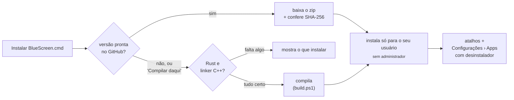

Instalado assim, a IDE procura atualizações ao abrir (veja [Atualização automática](#atualização-automática)).

### Linha de comando

```
BlueScreen.exe C:\meus\projetos    # outra pasta de projetos
BlueScreen.exe --lan               # já liga o acesso pela rede local
BlueScreen.exe --web               # abre no navegador em vez da janela
```

## Primeiros passos

1. **Escolha a pasta de projetos** na tela de boas-vindas. Cada subpasta vira um projeto, com Git ou SVN, branch e alterações pendentes.
2. **Abra um arquivo.** O BlueScreen procura o servidor da linguagem no `PATH`; se não houver, a status bar oferece instalar pelo terminal.
3. **Navegue como no IntelliJ:** `Shift` `Shift` para achar qualquer coisa, `Ctrl`+clique para ir à definição.
4. **Rode e depure:** `Ctrl+Shift+F10` executa o arquivo aberto, `Shift+F9` depura.
5. **Revise antes do commit:** `Alt+2` mostra o que mudou, com diff lado a lado e lint dos arquivos modificados.

| Atalho | O que faz |
|---|---|
| `Shift` `Shift` | buscar classes, arquivos, texto e ações |
| `Ctrl+B` / `Ctrl`+clique | ir para a definição |
| `Shift+F6` | renomear em todos os arquivos |
| `Alt+Enter` | ações rápidas e refatorações |
| `Alt+F7` | encontrar usos |
| `Shift+F9` | depurar o arquivo aberto (`F8` passa, `F7` entra, `F9` continua) |
| `Ctrl+F8` | marcar breakpoint (ou clique na margem) |
| `Ctrl+Shift+F10` | executar o arquivo aberto |
| `Ctrl+Alt+L` | lint do arquivo |
| `Alt+F12` | terminal |
| `Ctrl+Shift+V` | visualização de Markdown e HTML ao lado |
| `Alt+2` | alterações locais |
| `Alt+6` / `Alt+7` | Build / Plugins |
| `Ctrl+Alt+S` | aparência e temas |
| `F1` | todos os atalhos |

## Linguagens

O BlueScreen procura as ferramentas no `PATH` ao abrir o primeiro arquivo de cada linguagem. O item da status bar mostra qual está em uso; sem nenhuma, ele oferece instalar pelo terminal.

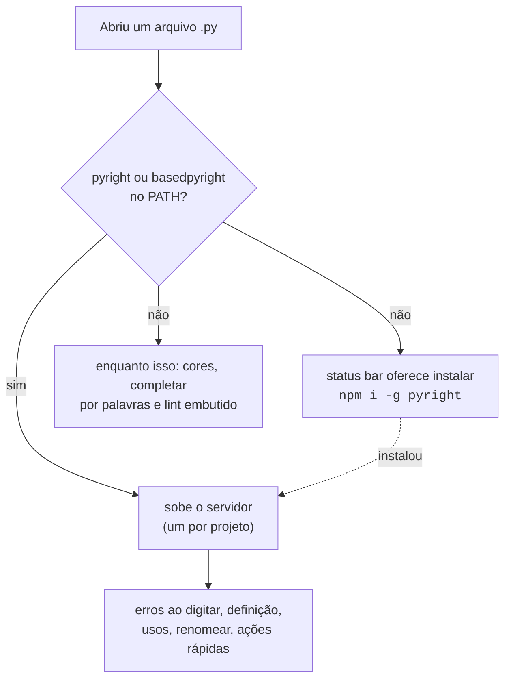

| Linguagem | Análise e refatoração | Depuração |
|---|---|---|
| Python | `npm i -g pyright` ou `pip install basedpyright` | `pip install debugpy` |
| Rust | `rustup component add rust-analyzer` | `winget install LLVM.LLVM` (lldb-dap) |
| Go | `go install golang.org/x/tools/gopls@latest` | `go install github.com/go-delve/delve/cmd/dlv@latest` |
| C e C++ | `winget install LLVM.LLVM` (clangd) | lldb-dap ou CodeLLDB |
| C# | `dotnet tool install -g csharp-ls` | `scoop install netcoredbg` |
| Java | Eclipse JDT LS (`jdtls`) | ainda não |
| JavaScript e TypeScript | `npm i -g typescript typescript-language-server` | ainda não |
| PHP, Ruby, Lua, Kotlin, Dart, Zig | Intelephense, Ruby LSP, LuaLS, Kotlin LS, Dart, ZLS | ainda não |
| HTML, CSS, JSON, YAML, XML, Bash | `vscode-langservers-extracted`, `yaml-language-server`, LemMinX, `bash-language-server` | não se aplica |

Sem servidor instalado, o editor continua com cores, completar por palavras, lint embutido e, para JavaScript e TypeScript, a análise do próprio Monaco. HTML e JSP ganham ainda `Ctrl`+clique em `href`/`src`/`action`, completar caminhos de arquivo e, nos `.jsp`, diretivas, ações `jsp:*` e as tags mais usadas da JSTL.

Para usar outra ferramenta ou outro caminho, liste em `~/.bluescreen/tools.json`:

```json
[{ "id": "meu-ls", "kind": "lsp", "name": "Meu servidor", "langs": ["python"], "command": "C:\\ferramentas\\meu-ls.exe", "args": ["--stdio"] }]
```

## Comparativo

Medido numa máquina com Ryzen 5 5600GT, 32 GB e Windows 11, em outubro de 2026. Cada IDE foi aberta na tela inicial e medida depois de 15 a 30 s parada, somando todos os processos dela.

| | BlueScreen 2.0 | WebStorm 2026.1.3 | Visual Studio Community 2026 |
|---|---|---|---|
| Instalação em disco | **25 MB** | 2,9 GB | 4,2 GB (só a pasta de instalação) |
| Memória privada, ociosa | **238 MB** | 744 a 763 MB | 498 a 512 MB |
| Primeira janela, a frio | **0,4 s** | 5,6 s (splash) | 0,8 s (splash) |

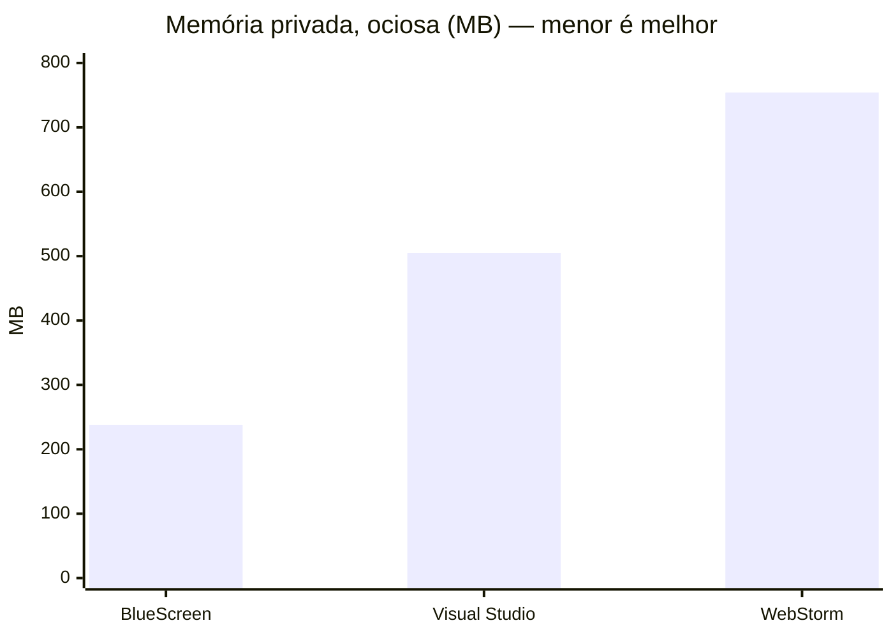

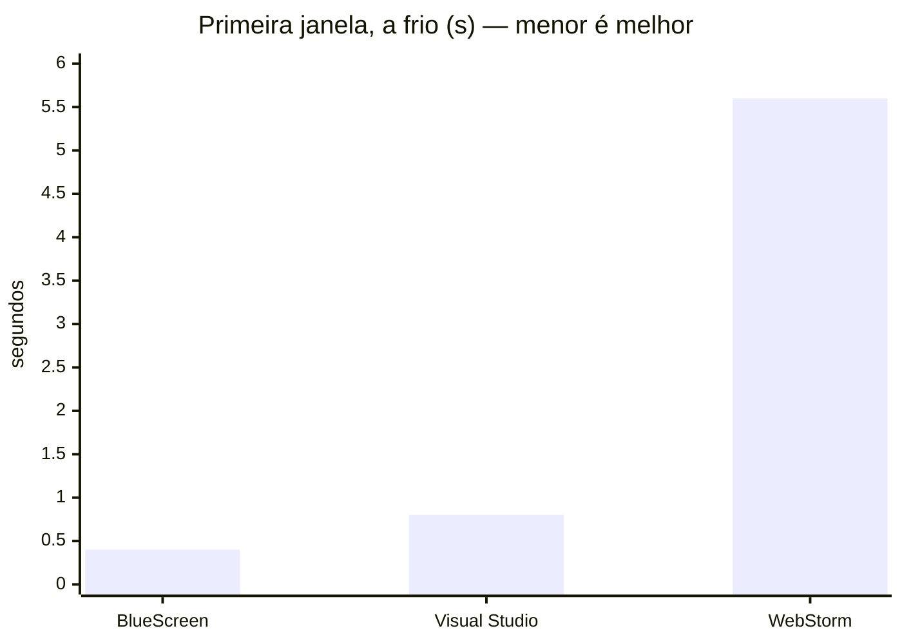

<sub>Nos gráficos, Visual Studio e WebStorm aparecem pelo meio da faixa medida.</sub>

A memória do BlueScreen inclui o WebView2 e os servidores de dois plugins. O runtime do WebView2 já vem com o Windows 11 e não entra na conta da instalação. Requisitos oficiais de outras: IntelliJ IDEA pede 8 GB de RAM e 10 GB de disco ([guia](https://www.jetbrains.com/help/idea/installation-guide.html)); VS Code pede 1 GB de RAM e menos de 500 MB de disco ([requisitos](https://code.visualstudio.com/docs/supporting/requirements)).

| Pronto para usar, sem extensões | BlueScreen | IntelliJ / WebStorm | VS Code | Visual Studio |
|---|---|---|---|---|
| Visualização de Markdown lado a lado | ✅ | ✅ | ✅ | ✅ |
| Visualização de HTML ao vivo | ✅ | ✅ | extensão | abre no navegador |
| Terminal com vários shells | ✅ | ✅ | ✅ | ✅ |
| Git / SVN | ✅ / ✅ | ✅ / plugin | ✅ / extensão | ✅ / extensão |
| Build reconhecido sozinho | ✅ (60+ ferramentas) | Maven, Gradle, npm e outros | tarefas ou extensões | MSBuild, CMake |
| Refatoração e análise semântica | ✅ pelo servidor da linguagem | ✅ próprio | por extensão | ✅ próprio |
| Depurador | ✅ pelo depurador da linguagem | ✅ | por extensão | ✅ |
| Abrir pelo celular, com PIN | ✅ | Code With Me (conta) | Remote Tunnels (conta) | não |

A análise própria do IntelliJ e do Visual Studio ainda vai mais fundo em Java e .NET (inspeções, refatorações estruturais). O BlueScreen fica com o que o servidor oficial de cada linguagem oferece.

## Recursos em detalhe

### Projetos, árvore e alterações

- A pasta de projetos lista cada subpasta, com Git ou SVN, branch, alterações locais e idade do último commit. Projetos de fora entram pelos recentes.
- A árvore segue o Project View do IntelliJ: módulos (`pom.xml`, `build.gradle`, `.project`) em negrito, source roots coloridos e classes com ícone de tipo (classe, interface, enum, anotação, abstrata).
- **Pastas compactadas:** cadeias de pastas que só têm a próxima dentro viram uma linha só, tanto em pacotes Java quanto em pastas comuns. Ao revelar um arquivo, a árvore seleciona a linha agrupada.

  ```
  Antes                         Depois
  ├─ src                        ├─ src/main/java
  │  └─ main                    │  └─ br.com.empresa.app
  │     └─ java                 │     ├─ App
  │        └─ br                │     └─ Config
  │           └─ com            └─ docs/api/v2
  │              └─ empresa        └─ openapi.yaml
  │                 └─ app
  │                    ├─ App
  │                    └─ Config
  ```

- Nomes coloridos pelas alterações, contador por pasta e bolinha de "não salvo" na aba, na árvore e na status bar.
- **Alterações** (`Alt+2`): o que não foi commitado, ou os arquivos de qualquer commit do Histórico. Diff lado a lado ou em linha, editável, com navegação entre trechos (`Alt+↓` / `Alt+↑`).
- Sem abas abertas, o editor mostra o README do projeto renderizado, ou uma visão geral com linguagens e sistemas de build.

### Análise, refatoração e depuração

O editor fala com os servidores pelo mesmo protocolo do VS Code. Um exemplo de "renomear em todos os arquivos":

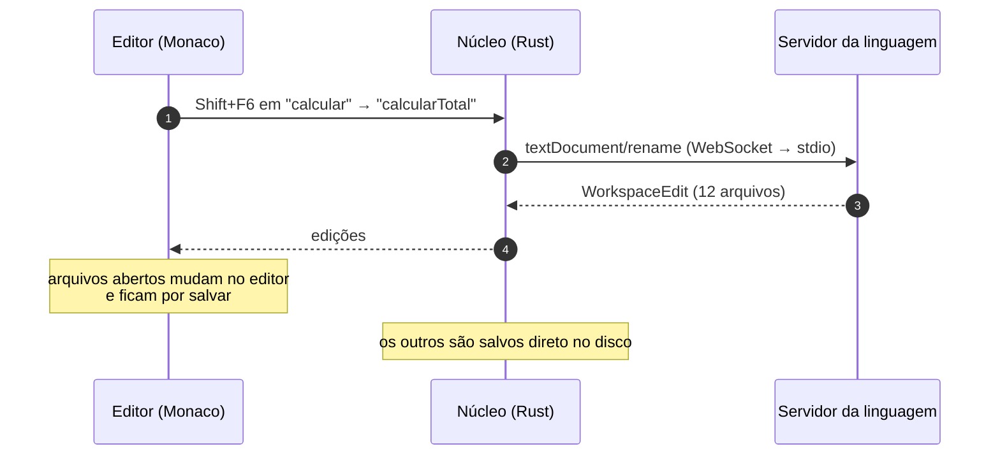

- Cada servidor de linguagem sobe no primeiro arquivo da linguagem, um por projeto, e fecha junto com o BlueScreen.
- `Alt+Enter` traz as correções e refatorações do servidor (extrair, organizar imports, implementar métodos...).
- O depurador lembra os breakpoints por projeto, acompanha as linhas quando o código muda e aceita condição (botão direito na margem).
- Pausado, passar o mouse sobre uma variável mostra o valor; o console avalia expressões no frame escolhido.
- Para C, C++, Rust e .NET, o BlueScreen pergunta qual executável depurar e lembra a resposta.

### Buscar em tudo

`Shift` duas vezes, até com o foco no editor. Abas Tudo, Classes, Arquivos, Texto e Ações.

| Você digita | Encontra |
|---|---|
| `PaCo` | `ParcelasController` (CamelHumps) |
| `servico.Cliente` | a classe `Cliente` no pacote `servico` |
| `web/index` | `src/web/index.html` |
| `App.java:42` | abre o arquivo na linha 42 |

A busca de texto percorre o projeto em paralelo, com opção de maiúsculas e regex. Atalhos diretos: `Ctrl+N` classes, `Ctrl+Shift+N` arquivos, `Ctrl+Shift+F` texto, `Ctrl+Shift+A` ações.

### Build e executar arquivo

O painel Build (`Alt+6`) reconhece os arquivos de build da pasta e das subpastas e agrupa as tarefas por sistema, usando o wrapper do projeto quando existe (`mvnw`, `gradlew`...).

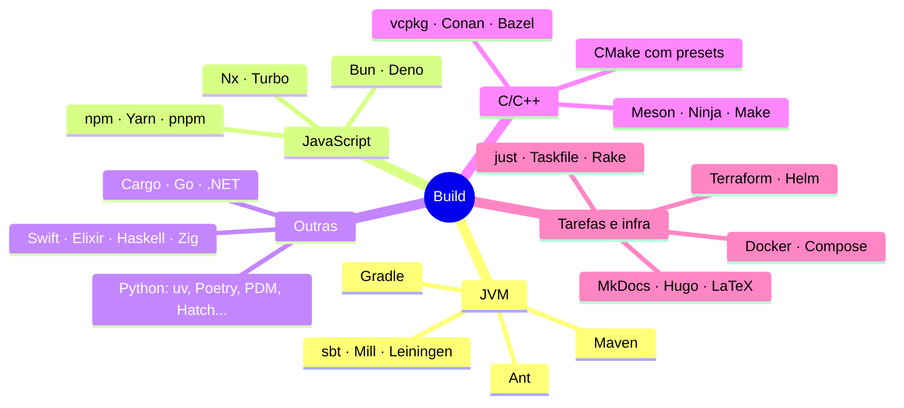

- **JVM:** Maven (pom agregador, escolha de Maven, JDK e repositório), Gradle, Ant, sbt, Mill, Leiningen.
- **JavaScript:** npm, Yarn, pnpm, Bun, Deno, Nx, Turbo.
- **Outras:** Cargo, Go, .NET, Python (uv, Poetry, PDM, Hatch, Pipenv, Conda, pip, tox), Swift, Elixir, Erlang, Haskell, OCaml, Zig, Crystal, Julia, R, Elm, PHP.
- **C/C++ e geradores:** CMake (com presets), Meson, Ninja, Make, xmake, SCons, Premake, vcpkg, Conan, Bazel, Buck2, Pants.
- **Tarefas e infraestrutura:** just, Taskfile, Rake, Docker, Docker Compose, Terraform, Helm, MkDocs, Hugo, LaTeX.

`Ctrl+Shift+F10` executa o arquivo aberto pela linguagem dele. O console mostra a saída ao vivo, com erros clicáveis e um resumo do que falhou.

### Dependências não instaladas

Ao abrir o projeto, o BlueScreen confere se os manifestos (na raiz e até dois níveis abaixo) já têm o que pedem baixado. Faltando algo, um aviso no canto oferece o comando certo, que roda no terminal da IDE, na pasta certa.

| Manifesto | Confere | Oferece |
|---|---|---|
| `package.json` | `node_modules/<pacote>` aqui ou numa pasta acima (workspaces) | `npm install` (ou Yarn, pnpm, Bun) |
| `requirements.txt`, `pyproject.toml`, `Pipfile` | um ambiente virtual (`.venv`, `venv`, `env`) | `uv sync`, `poetry install`, `pipenv install` ou criar a `.venv` e `pip install` |
| `composer.json` | `vendor/autoload.php` | `composer install` |
| `*.csproj` | `obj/project.assets.json` | `dotnet restore` |
| `pubspec.yaml` | `.dart_tool/package_config.json` | `dart pub get` / `flutter pub get` |
| `Gemfile` / `go.mod` | `Gemfile.lock` / `go.sum` | `bundle install` / `go mod download` |

Quando a instalação termina, os servidores de linguagem reiniciam sozinhos para os erros antigos ("Cannot find module", "No module named"...) sumirem. Se esses erros voltarem a aparecer no editor, o aviso volta também.

### Lint embutido

`Ctrl+Alt+L` ou ao salvar, sem instalar nada. São três camadas, e cada arquivo cai na mais precisa que existe para ele:

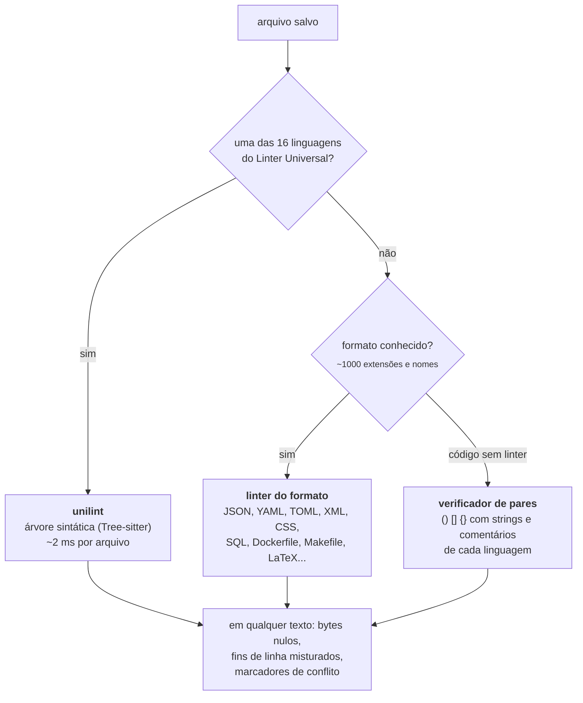

- **Linter Universal** (plugin `unilint`, ligado por padrão): Python, JavaScript, TypeScript, TSX, Java, Rust, Go, C, C++, C#, Kotlin, PHP, Ruby, Lua, Bash e PowerShell. Acha código inalcançável, imports e variáveis não usados, `x = x`, condições repetidas, `catch` vazio, chave duplicada, `debugger` esquecido e mais. Aceita os comentários de supressão das ferramentas originais (`# noqa`, `eslint-disable`, `NOLINT`, `#[allow]`, `@SuppressWarnings`...). Detalhes em [app/plugins/unilint/README.md](app/plugins/unilint/README.md).
- **Linters de formato**, no núcleo: Java (`javac` com o classpath do projeto), JS/TS (ESLint quando configurado), HTML/JSP e templates (Twig, Jinja, Liquid, Handlebars, Go), XML e dialetos (`.csproj`, `.xaml`, `.plist`...), CSS/SCSS/Less, JSON, JSONC e JSON Lines, YAML, TOML, INI, `.env`, CSV/TSV, properties, SQL, Markdown, LaTeX, VB/VBA, `MANIFEST.MF`, `.po`, diff/patch, legendas SRT/VTT, PowerShell, Bash e Python.
- **Verificador de pares** para centenas de linguagens sem linter próprio: shaders, Lisp, Haskell, Fortran (inclusive formato fixo), Pascal, Erlang, MATLAB, Julia, HCL, GraphQL, protobuf, Nix...
- Extensões ambíguas (`.m`, `.v`, `.cls`, `.pl`, `.conf`, `.config`...) são decididas pelo começo do conteúdo. Arquivos em UTF-16 com BOM, comuns em `.reg`, `.ps1` e `.bat`, são lidos direito.

O ícone ✓ do painel Alterações roda o lint em todos os arquivos modificados.

### Arquivos gigantes

Logs, dumps e CSVs de vários GB abrem na hora: o arquivo nunca é carregado inteiro.

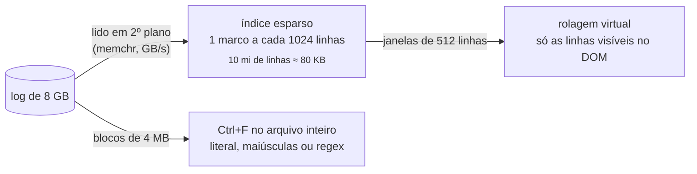

- A página já mostra o começo enquanto o índice é montado.
- Um log que continua crescendo é acompanhado sem reler o começo.
- Linhas gigantes (um JSON minificado de 200 MB numa linha só) são cortadas na exibição.
- A rolagem vai a qualquer linha, mesmo num arquivo de bilhões de linhas.

### Alterações feitas fora da IDE

O núcleo vigia a pasta do projeto com a mesma API do Windows que o Explorer usa. Um `git pull`, um formatador, outro editor ou um agente de IA gravou no disco? A aba se atualiza sozinha.

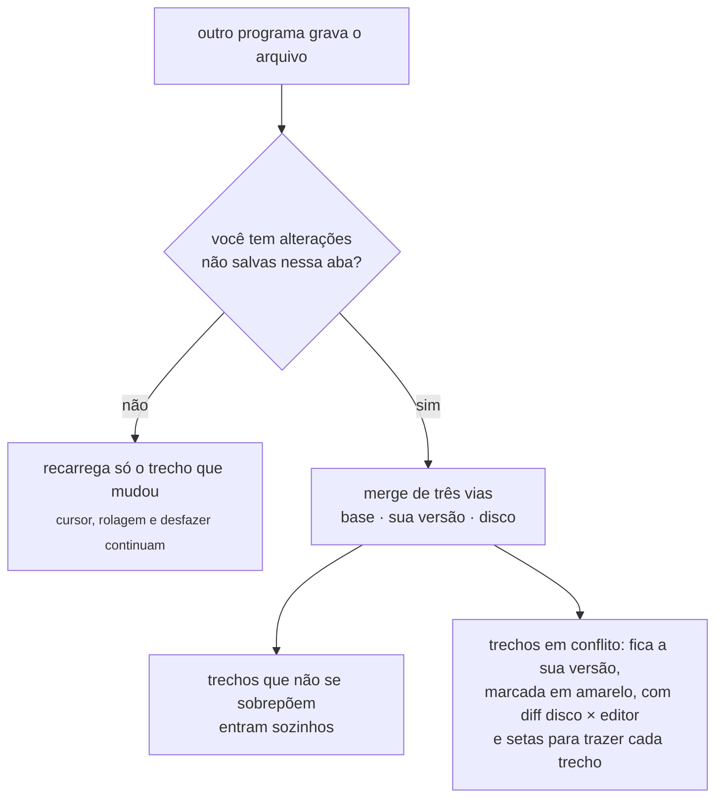

Pastas pesadas e geradas (`node_modules`, `target`, `.git/objects`...) ficam de fora; do `.git` só interessa o que muda o estado do repositório (HEAD, index, refs), e aí as marcas de alteração se atualizam.

### Terminal

Cada aba é um shell de verdade num pseudoconsole do Windows (ConPTY), com cores e programas de tela cheia. Encontra sozinho PowerShell 7, Windows PowerShell, cmd, Git Bash, WSL, MSYS2, Cygwin, Nushell, os prompts de desenvolvedor do Visual Studio e os perfis do Windows Terminal. `caminho:linha` na saída vira link para o arquivo. Os atalhos da IDE não roubam as teclas do shell.

Terminal, Depurar, Build, Problemas e os painéis de plugins dividem o mesmo espaço embaixo do editor, em abas: o que acabou de abrir fica na frente, clicar na aba da frente recolhe o painel e arrastar a borda ajusta a altura.

### Visualização de Markdown e HTML

Três modos no canto do editor, lembrados por tipo de arquivo:

```
┌──────────────┐   ┌───────┬───────┐   ┌──────────────┐
│ ▤ editor     │   │ ▤     │ ◫     │   │ ◫ visualiza- │
│              │   │ edi-  │ visu- │   │   ção        │
│              │   │ tor   │ al    │   │              │
└──────────────┘   └───────┴───────┘   └──────────────┘
   só editor        editor + visual      só visualização
```

O Markdown é refeito só no bloco editado e rola junto com o código. O HTML roda isolado, com o texto ainda não salvo, e carrega CSS, imagens e scripts relativos do projeto.

### Rede local

O ícone de wifi liga um segundo endereço (`http://<ip-do-pc>:4748`) protegido por PIN, para abrir no celular ou em outro PC.

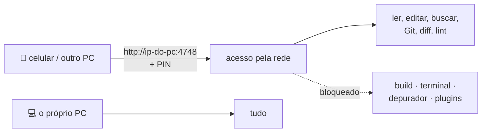

Build, terminal, depurador e plugins só respondem no próprio PC, porque rodam programas na sua máquina.

### Aparência

`Ctrl+Alt+S` abre a Aparência: dez temas prontos e tudo editável ao vivo (cores da interface e do código, fontes, tamanhos, cantos). Temas exportam e importam em JSON.

### Atualização automática

Cada push na `main` que mexe no aplicativo vira uma versão nova: o GitHub Actions ([`release.yml`](.github/workflows/release.yml)) roda os testes, compila no Windows e publica num Release `vX.Y.Z` o setup (`BlueScreen-Setup-X.Y.Z.exe`, feito com o Inno Setup a partir de [`app/installer/BlueScreen.iss`](app/installer/BlueScreen.iss)) e o zip, com a lista do que mudou. O BlueScreen instalado confere o último Release toda vez que abre:

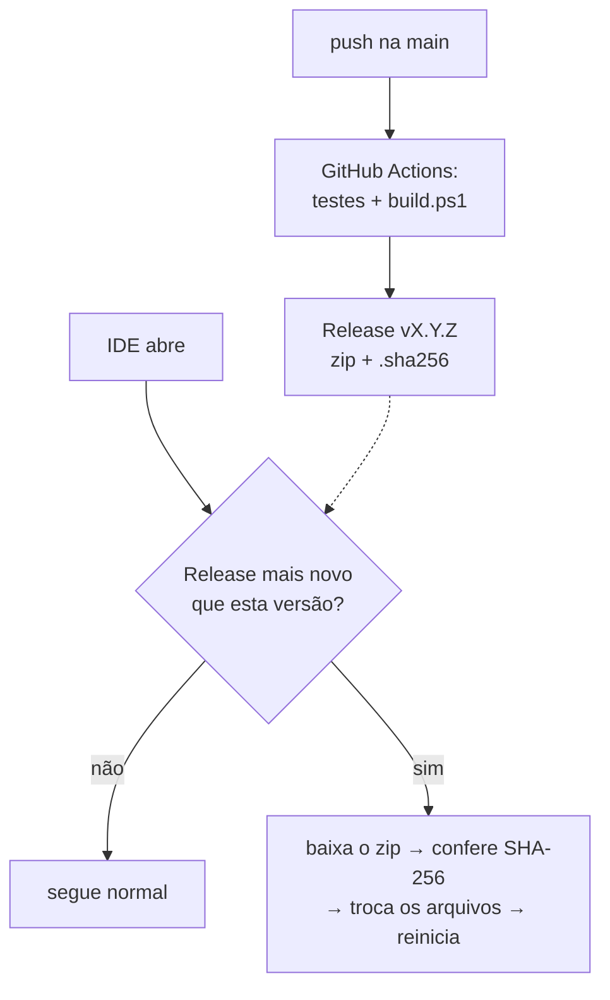

**Versões.** `X.Y` vem do `app/Cargo.toml` (mude lá para subir a versão maior ou a menor); `Z` é o próximo número livre entre as tags `vX.Y.*`. Para um push não gerar versão, ponha `[skip release]` na mensagem do commit.

**Rodando do código-fonte** (`app\target\...`, `app\dist\...`), ou sem acesso ao GitHub, a atualização é pelo git: `git pull` e, se mudou Rust, compila só os pacotes afetados (o núcleo ou o plugin que mudou) e reinicia; se mudou só a interface, a página recarrega.

O Windows não deixa sobrescrever um `.exe` em uso, mas deixa renomear: a versão antiga vira `*.old-<n>.exe` e é apagada no próximo início.

## Como funciona por dentro

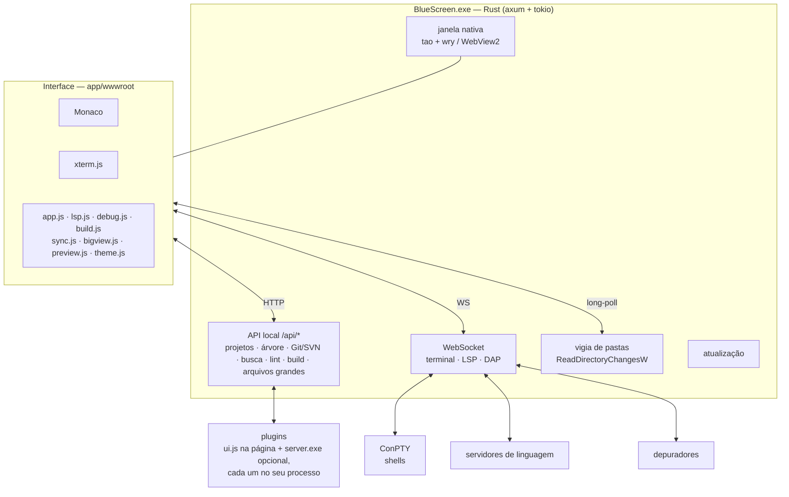

| Pasta | O que tem |
|---|---|
| `app/src` | o núcleo: `server.rs` (rotas), `workspace.rs` (árvore e busca), `terminal.rs`, `rpc.rs` (LSP e DAP), `lint.rs` e `lint_formats.rs`, `bigfile.rs` (arquivos grandes), `watch.rs` (vigia), `deps.rs` (dependências), `update.rs`, `desktop.rs` (janela), `build/`, `plugins/` |
| `app/sdk` | base comum do núcleo e dos plugins: processos, Git/SVN, servidor de plugin |
| `app/wwwroot` | a interface: `app.js`, `lsp.js`, `debug.js`, `terminal.js`, `preview.js`, `html.js`, `build.js`, `sync.js`, `bigview.js`, `deps.js`, `dock.js`, `theme.js` |
| `app/plugins` | plugins que vêm junto, cada um com o próprio README |
| `docs` | guia de plugins e as imagens deste README |
| `assets` | o ícone (SVG, PNG e ICO) |

## Compilar

Precisa do Rust (toolchain stable MSVC) e do Visual Studio Build Tools com C++. Na pasta `app`:

```
cargo build --workspace; cargo run -- C:\meus\projetos   # desenvolvimento
powershell -File build.ps1                               # versão final em app\dist\BlueScreen
powershell -File build.ps1 -Plugin <id>                  # só um plugin
powershell -File build.ps1 -Packages bluescreen          # recompila só o núcleo (os plugins vêm da compilação anterior)
```

O perfil de release usa LTO "thin" com 16 unidades de código: a compilação usa todos os núcleos do processador (recompilar só o núcleo leva ~30 s, contra ~90 s com LTO "fat").

A interface (`app/wwwroot`) não passa por build: edite o `.js` ou o `.css` e recarregue a página. Só mudanças em `app/src` pedem `cargo build`.

## Plugins

Plugins acrescentam painéis, atalhos, ações, cards e tarefas de build, e podem ter um servidor próprio em qualquer linguagem. Ligam e desligam na aba Plugins (`Alt+7`), sem recompilar nada.

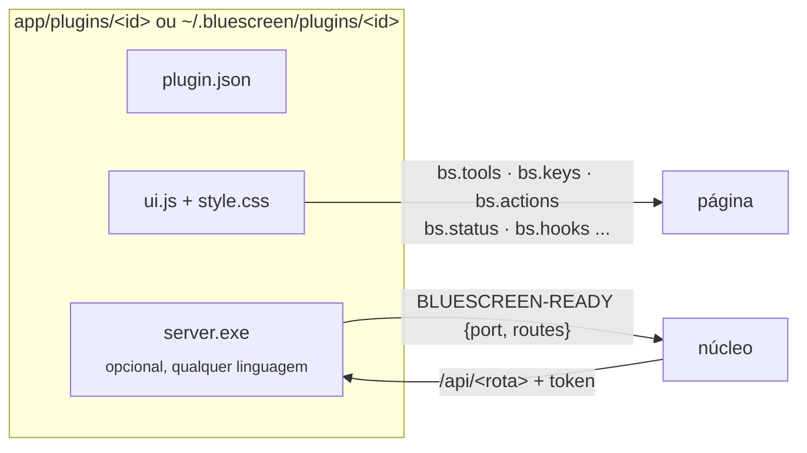

Exemplo, um item de menu na árvore:

```js
bs.hooks.filter('menu:file', (items, ctx) => [...items, '-', {
  label: 'Contar linhas', icon: bs.I.lint,
  action: async () => { const f = await bs.api('file', { project: bs.S.project.path, file: ctx.rel }); bs.toast(f.content.split('\n').length + ' linhas'); },
}]);
```

| Plugin que vem junto | O que faz |
|---|---|
| [Linter Universal](app/plugins/unilint/README.md) (`unilint`) | lint de 16 linguagens por árvore sintática, sem baixar linters; analisa o projeto inteiro pelo `Shift` `Shift` |

Como escrever um: [docs/PLUGINS.md](docs/PLUGINS.md).

## Perguntas frequentes

<details>
<summary><b>Preciso instalar algo além do BlueScreen?</b></summary>

Para editar, buscar, usar Git, terminal, build e lint, não. Para análise semântica e depuração de uma linguagem, sim: o servidor e o depurador oficiais dela (a tabela de [Linguagens](#linguagens) mostra o comando). A status bar oferece instalar quando falta.
</details>

<details>
<summary><b>Funciona em Linux ou macOS?</b></summary>

Não. O BlueScreen usa recursos do Windows de propósito (WebView2, ConPTY, ReadDirectoryChangesW). Dá para abrir a interface no navegador de outro aparelho pela rede local, mas o núcleo roda no Windows.
</details>

<details>
<summary><b>É seguro ligar o acesso pela rede local?</b></summary>

O acesso pede PIN, e tudo que executa programas (build, terminal, depurador, plugins) só responde no próprio PC. Mesmo assim, use em redes em que você confia.
</details>

<details>
<summary><b>Onde ficam as configurações?</b></summary>

Em `~/.bluescreen/`: `tools.json` (ferramentas próprias), `plugins.json` (plugins ligados), `plugins/` (seus plugins) e `bluescreen.log` (log, inclusive dos servidores de plugin).
</details>

<details>
<summary><b>Como sei qual servidor de linguagem está em uso?</b></summary>

Pelo item da linguagem na status bar. Clicando nele dá para reiniciar o servidor ou procurar as ferramentas de novo (depois de instalar uma, sem reiniciar a IDE).
</details>

## Contribuir

Correções, ideias e plugins são bem-vindos. Veja [CONTRIBUTING.md](CONTRIBUTING.md) para rodar em modo de desenvolvimento e o que conferir antes de abrir um pull request.

## Créditos

O BlueScreen usa [Monaco Editor](https://github.com/microsoft/monaco-editor) e [xterm.js](https://github.com/xtermjs/xterm.js) (MIT), [marked](https://github.com/markedjs/marked) (MIT), [DOMPurify](https://github.com/cure53/DOMPurify) (Apache 2.0 / MPL 2.0), as fontes [IBM Plex Sans](https://github.com/IBM/plex) e [JetBrains Mono](https://github.com/JetBrains/JetBrainsMono) (OFL), e no núcleo [axum](https://github.com/tokio-rs/axum), [tokio](https://tokio.rs), [wry e tao](https://github.com/tauri-apps), [portable-pty](https://github.com/wezterm/wezterm) e [Tree-sitter](https://tree-sitter.github.io) (no Linter Universal). Cada um segue a própria licença; a lista completa, com as bibliotecas Rust, está em [THIRD-PARTY-NOTICES.md](THIRD-PARTY-NOTICES.md).

## Licença

Copyright (c) 2025-2026 Martin Hartfelder. Todos os direitos reservados.

O código está aberto para leitura, uso e contribuições, mas **não é software livre**: copiar, redistribuir, publicar versões modificadas ou usar comercialmente partes do BlueScreen exige autorização por escrito. Plugins próprios feitos com o SDK podem ser distribuídos sob a licença que o autor do plugin quiser. Os termos completos estão em [LICENSE](LICENSE); componentes de terceiros mantêm as licenças deles ([THIRD-PARTY-NOTICES.md](THIRD-PARTY-NOTICES.md)).
